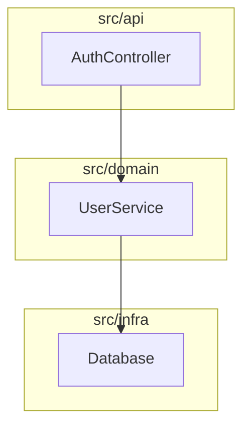

# Brooks-Lint 代码质量审查

目标：对指定代码（PR diff、文件、模块或整个项目）进行结构化质量诊断，找出可维护性风险并给出可执行的改进建议。

**核心原则（Iron Law）**：
- 完成风险诊断前，**绝不建议修复方案**
- 每个发现必须遵循：**Symptom（症状）→ Source（来源书籍/原则）→ Consequence（后果）→ Remedy（补救）**
- 没有后果和补救的发现是噪音，不是发现

## 六个 Decay Risk 维度

### R1: Cognitive Overload（认知过载）
**诊断问题**：理解这段代码需要多少脑力？

**典型症状**：
- 函数超过 20 行且混合多个抽象层级
- 嵌套深度 > 3 层
- 参数列表 > 4 个
- 魔法数字或未解释的常量
- 变量名需要读实现才能理解（如 `d`, `tmp2`, `flag`）
- 布尔表达式组合 3+ 个条件
- 火车残骸链：`a.getB().getC().doD()`
- Flag Arguments：布尔参数让函数做两件根本不同的事
- Primitive Obsession：用原始类型表示领域概念（`String email`, `int orderId`）
- Shallow module：接口复杂度相对于提供的功能过于复杂

**来源**：
- Fowler《重构》：Long Method, Long Parameter List, Message Chains, Flag Arguments, Primitive Obsession
- McConnell《代码大全》：Ch.7 高质量例程, Ch.11 变量命名的力量, Ch.12 基本数据类型
- Evans《领域驱动设计》：Ubiquitous Language（领域名称不匹配）
- Ousterhout《软件设计哲学》：Ch.4 模块应该深（Shallow Module）

**严重度**：
- 🔴 Critical：函数 > 50 行，嵌套 > 5 层，或几乎没有有意义的名称
- 🟡 Warning：函数 20-50 行，嵌套 4-5 层，部分名称不清
- 🟢 Suggestion：轻微命名问题，1-2 个魔法数字，孤立的火车残骸链

**不要标记**：
- 有清晰名称和 guard clauses 的线性代码
- 深模块边界后隐藏的内部实现细节
- 与专家实际用语匹配的领域术语

---

### R2: Change Propagation（变更传播）
**诊断问题**：改变一件事会破坏多少不相关的东西？

**典型症状**：
- 修改一个功能需要改动 3+ 个不相关模块的文件
- 一个类因多个不同业务原因而改变（如 `UserService` 同时因计费、通知、资料逻辑而变）
- 一个方法使用另一个类的数据多于自己类的数据
- 两个类直接知道对方的内部状态
- **Hyrum's Law**：调用者足够多时，每个可观察行为（包括实现细节、错误消息文本、偶然的调用顺序）都成为隐式契约
- **Orthogonality violation**：改变一个维度迫使编辑不相关维度
- Information Leakage：设计决策（文件格式、协议细节、数据形状）编码在多个模块中

**来源**：
- Fowler《重构》：Shotgun Surgery, Divergent Change, Feature Envy, Inappropriate Intimacy
- Hunt & Thomas《程序员修炼之道》：Ch.2 Orthogonality
- Martin《整洁架构》：Dependency Inversion Principle
- Brooks《人月神话》：Ch.2 Brooks's Law（沟通开销、传播半径）
- Winters et al.《Google 软件工程》：Ch.1 Hyrum's Law
- Ousterhout《软件设计哲学》：Ch.5 Information Hiding and Leakage

**严重度**：
- 🔴 Critical：一次改动触及 > 5 个文件，或存在结构性依赖倒置（领域依赖基础设施）
- 🟡 Warning：一次改动触及 3-5 个文件，模块间轻度耦合
- 🟢 Suggestion：轻微耦合，容易隔离

**不要标记**：
- 组合根装配具体依赖本身不是 DIP 违规
- 有意支持的行为的稳定公共 API 不自动是 Hyrum's Law 债务
- 一个限界上下文内的类似编辑可能是正常的协调变更

---

### R3: Knowledge Duplication（知识重复）
**诊断问题**：同一个决策是否在多处表达？

**典型症状**：
- 相同逻辑在多个文件或函数间复制粘贴
- 同一概念在代码库不同部分命名不同（`user`, `account`, `member`, `customer` 指同一实体）
- 平行类层次结构必须同步改变
- 配置值在多处重复为字面量
- 两个模块独立实现相同算法

**来源**：
- Fowler《重构》：Duplicate Code, Parallel Inheritance Hierarchies, Alternative Classes with Different Interfaces
- Hunt & Thomas《程序员修炼之道》：DRY: Don't Repeat Yourself
- Evans《领域驱动设计》：Ubiquitous Language（命名不一致）

**严重度**：
- 🔴 Critical：重复决策已在关键工作流中造成广泛严重后果，或领域含义分歧使高影响变更不安全
- 🟡 Warning：实现间的有界策略漂移，需要协调变更的重复决策，子系统内有意义的命名不一致
- 🟢 Suggestion：轻微字面量重复或单个局部命名不一致，有具体但有限的维护后果

**不要标记**：
- 跨越独立限界上下文的重复不自动是重复知识
- 活跃提取或迁移期间的临时重复不一定是债务
- 在显式边界处重复的共享协议常量可能是可接受的

---

### R4: Accidental Complexity（意外复杂性）
**诊断问题**：代码是否比它解决的问题更复杂？

**典型症状**：
- 为"未来使用"构建的抽象，当前没有消费者（如只有一个已知实现的插件系统）
- 几乎无法证明存在合理性的类（包装单个方法调用）
- 只委托给另一个类而不添加行为的类（纯中间人）
- 系统的第二次尝试比第一次显著更精细，为尚不存在的需求添加通用性
- 标志着缺少多态的 switch 语句
- 从未从默认值改变过的配置选项
- 框架代码比它驱动的应用还大
- 在持续战术捷径下生长的代码

**来源**：
- Fowler《重构》：Speculative Generality, Lazy Class, Middle Man, Switch Statements
- Brooks《人月神话》：Ch.5 The Second-System Effect
- McConnell《代码大全》：Ch.5 构造中的设计（YAGNI）
- Hunt & Thomas《程序员修炼之道》：Topic 4 Good-Enough Software（过度工程）
- Ousterhout《软件设计哲学》：Ch.3 战略式 vs 战术式编程

**严重度**：
- 🔴 Critical：围绕推测性需求构建的整个子系统，或框架开销主导领域逻辑
- 🟡 Warning：多个不必要的抽象或包装类，未使用的配置系统
- 🟢 Suggestion：非关键路径中的一个或两个 lazy class 或 middle-man 模式

**不要标记**：
- 外部协议、线格式或封闭枚举上的 switch 不自动是缺少多态
- 吸收供应商变动或隐藏不稳定性的薄包装可能是合理的
- 更大的第二版不是 second-system effect，除非添加的通用性超过当前需求

---

### R5: Dependency Disorder（依赖混乱）
**诊断问题**：依赖是否沿一致、可预测的方向流动？

**典型症状**：
- 模块或包之间的循环依赖
- 高层业务逻辑直接从低层基础设施导入（如领域服务从特定数据库驱动导入）
- 稳定、广泛使用的组件依赖不稳定、频繁变化的组件
- 抽象组件依赖具体实现
- 迪米特法则违规：`order.getCustomer().getAddress().getCity()`
- 模块扇出 > 5（从 5+ 个其他模块导入）
- 模块实现接口但只使用方法子集，或必须为不需要的方法提供 stub（ISP 违规）
- 系统感觉"不是一个头脑设计的"——不同模块使用不兼容的架构模式
- 对传递包的直接版本锁定依赖（菱形依赖风险）

**来源**：
- Martin《整洁架构》：Acyclic Dependencies (ADP), Dependency Inversion (DIP), Stable Dependencies (SDP), Stable Abstractions (SAP), Interface Segregation (ISP), Single Responsibility, Open/Closed
- Brooks《人月神话》：Ch.4 Conceptual Integrity
- Hunt & Thomas《程序员修炼之道》：Ch.5 Decoupling and the Law of Demeter
- Winters et al.《Google 软件工程》：Ch.21 Dependency Management（菱形依赖、升级阻塞）

**严重度**：
- 🔴 Critical：存在依赖循环，或领域层直接依赖基础设施层
- 🟡 Warning：多个 SDP 或 DIP 违规但无循环；模块间概念不一致
- 🟢 Suggestion：轻微迪米特违规，隔离模块中略微升高的扇出

**不要标记**：
- 编排层或组合根中的高扇出不自动是混乱
- 当它们显式跨边界翻译时，适配器模块可能依赖领域和基础设施
- 如果依赖策略清晰，许多叶依赖上的稳定门面可能是健康的

---

### R6: Domain Model Distortion（领域模型失真）
**诊断问题**：代码是否忠实表示它正在解决的问题？

**典型症状**：
- 代码与业务语言不匹配，迫使心理翻译
- 领域概念在代码中没有对应物（如订单状态机用布尔标志表示）
- 业务规则分散在多个地方而不是封装在领域对象中
- 领域对象只是数据持有者（贫血领域模型）
- 通用语言与代码命名不一致
- 领域逻辑泄漏到控制器、服务或 UI 层

**来源**：
- Evans《领域驱动设计》：Ubiquitous Language, Bounded Context, Aggregates, Domain Events
- Fowler《重构》：Feature Envy, Data Clumps
- Ousterhout《软件设计哲学》：Ch.4 深模块

**严重度**：
- 🔴 Critical：领域模型与业务需求根本不匹配，导致频繁的高影响变更
- 🟡 Warning：领域概念表示不完整或命名不一致，导致理解成本
- 🟢 Suggestion：局部领域逻辑泄漏或轻微命名不匹配

**不要标记**：
- 简单 CRUD 应用可能不需要丰富的领域模型
- 技术关注点（日志、缓存）不属于领域模型
- 外部系统集成点可能需要翻译层

---

## 审查流程

### 1. 确定范围
- **PR Review**：`git diff --cached` → `git diff` → `git diff main...HEAD` → 询问用户
- **Architecture Audit / Tech Debt**：默认整个项目；`--since=<date>` 只分析变更模块
- **Test Quality**：默认所有测试文件；如有 diff，优先分析与变更生产文件同位的测试
- **Health Dashboard**：整个项目或指定路径

**范围行**：始终说明检测到的范围——如 `Scope: staged changes (3 files)` 或 `Scope: branch changes vs main (12 files)`

### 2. 读取项目配置（可选）
尝试从项目根读取 `.brooks-lint.yaml`：

```yaml
version: 1
strictness: balanced  # strict / balanced / legacy-friendly
disable:
  - T5  # 跳过的风险代码
severity:
  R1: suggestion  # 覆盖特定风险的严重度
ignore:
  - "**/*.generated.*"
  - "**/vendor/**"
focus:  # 只评估列出的风险（不能与 disable 同时使用）
  - R1
  - R2
```

### 3. 扫描每个风险维度
按 R1 → R2 → R3 → R4 → R5 → R6 顺序扫描代码，对每个发现应用 Iron Law。

### 4. 计算健康评分
基于发现的严重度和影响范围计算 0-100 的健康评分：
- 🔴 Critical：-15 到 -25 分
- 🟡 Warning：-5 到 -10 分
- 🟢 Suggestion：-1 到 -3 分

根据 `strictness` 调整扣分权重：
- `strict`：更重扣分
- `balanced`：默认权重
- `legacy-friendly`：更轻扣分，Summary 以三个最高杠杆修复开头

### 5. 输出报告

使用以下模板：

```markdown
# Brooks-Lint Review

**Mode:** [PR Review / Architecture Audit / Tech Debt Assessment / Test Quality Review / Health Dashboard]
**Scope:** [审查的文件、目录或描述]
**Health Score:** XX/100

[一句话总体判断]

---

## Module Dependency Graph

（如果是 Architecture Audit，生成 Mermaid 依赖图）



---

## Findings

### 🔴 Critical

**[R2] Change Propagation — UserService 承担四个不相关业务职责 (Critical)**
- **Symptom**: `update_profile` 方法同时执行资料字段更新、邮件变更通知、忠诚度积分重算和缓存失效
- **Source**: Fowler《重构》— Divergent Change; Hunt & Thomas《程序员修炼之道》— Orthogonality
- **Consequence**: 任何对忠诚度公式的改动都可能破坏邮件通知，反之亦然。每次编辑都带有跨四个不相关领域的回归风险
- **Remedy**: 提取 `NotificationService`, `LoyaltyService`, `UserCacheInvalidator`。`UserService.update_profile` 应该通过调用每个服务来编排，本身不持有实现逻辑

### 🟡 Warning

**[R1] Cognitive Overload — 嵌套深度 4 层且混合抽象 (Warning)**
- **Symptom**: ...
- **Source**: ...
- **Consequence**: ...
- **Remedy**: ...

### 🟢 Suggestion

**[R3] Knowledge Duplication — 配置值在 3 处重复 (Suggestion)**
- **Symptom**: ...
- **Source**: ...
- **Consequence**: ...
- **Remedy**: ...

---

## Summary

[2-3 句话：最重要的行动是什么，整体趋势如何]
```

**语言规则**：
- 报告正文使用用户使用的语言（中文用户用中文）
- 保持英文：Iron Law 字段标签（Symptom / Source / Consequence / Remedy）、书籍标题、原则和代码异味名称（如 "Shotgun Surgery", "Divergent Change"）、固定结构标题（`Findings`, `Summary`, `Critical`, `Warning`, `Suggestion`）

## 不要做

- **不要在没有证据的情况下推断生产规模、发布暴露或紧迫性**
- **不要将假设的最坏情况或风险代码本身作为严重度依据**
- **不要为风格偏好产生发现**——必须有具体后果
- **不要在诊断完成前建议修复**
- **不要跳过 "What Not to Flag" 保护**——它们防止误报
- **不要为不完整的审查输出评分**——明确说明限制

## 严重度校准

完成每个 Iron Law 诊断后，从其证据后果和影响范围选择严重度，**在计算评分之前**：

- **🔴 Critical**：证据确立严重影响和相关暴露，如数据丢失、安全妥协、关键工作流的广泛失败，或使高影响变更不安全的架构/测试障碍。在 Consequence 中说明受影响的行为、范围和证据
- **🟡 Warning**：证明的行为缺陷、变更行为中的有意义保护缺口，或需要纠正的重复变更负担，但证据未确立 Critical 影响
- **🟢 Suggestion**：有支持的局部可维护性或回归保护改进，有有限的证据影响

**区分当前缺陷与防止复发的额外建议**。不要继承缺陷的严重度给建议。反之，不要仅因代码短就降级有证据的高影响条件。

## 参考书籍

本方法论综合自十二本经典软件工程书籍：

1. **The Mythical Man-Month** (1975) - Frederick P. Brooks Jr. → R2, R4, R5
2. **Code Complete** (1993, 2nd ed. 2004) - Steve McConnell → R1, R4
3. **Refactoring** (1999, 2nd ed. 2018) - Martin Fowler → R1, R2, R3, R4, R6
4. **Clean Architecture** (2017) - Robert C. Martin → R2, R5
5. **The Pragmatic Programmer** (1999, 20th Anniv. 2019) - Andrew Hunt & David Thomas → R2, R3, R4, R5
6. **Domain-Driven Design** (2003) - Eric Evans → R1, R3, R6
7. **A Philosophy of Software Design** (2018) - John Ousterhout → R1, R4
8. **Software Engineering at Google** (2020) - Winters, Manshreck & Wright → R2, R5
9. **The Art of Unit Testing** (2009, 3rd ed. 2023) - Roy Osherove → 测试风险 T1, T2, T4, T5
10. **How Google Tests Software** (2012) - Whittaker, Arbon & Carollo → 测试风险 T5, T6
11. **Working Effectively with Legacy Code** (2004) - Michael Feathers → 测试风险 T4, T5, T6
12. **xUnit Test Patterns** (2007) - Gerard Meszaros → 测试风险 T1, T2, T3, T4

完整来源覆盖、例外和权衡见原始项目：https://github.com/hyhmrright/brooks-lint
